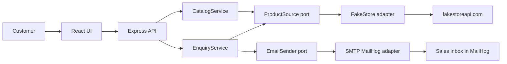
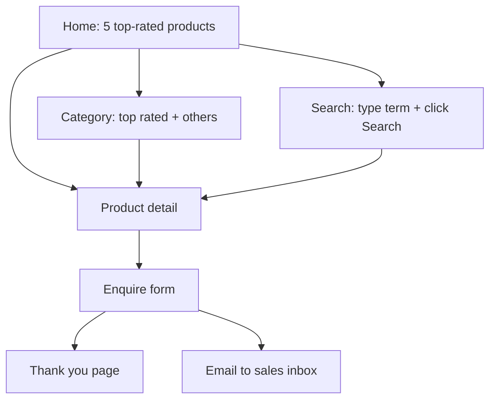
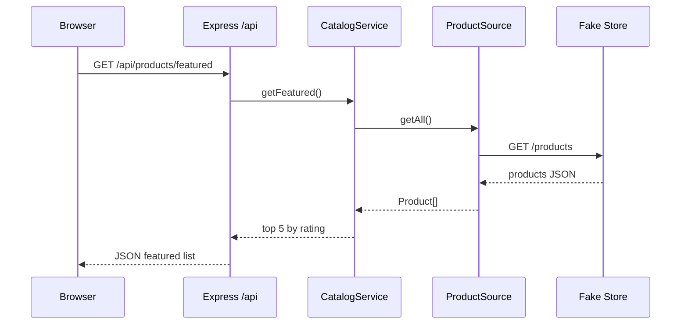
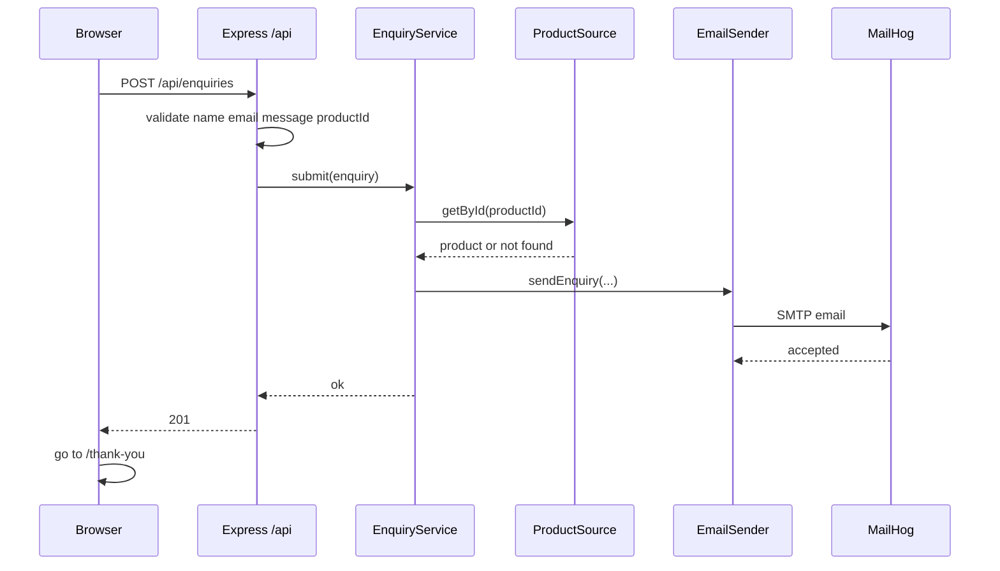
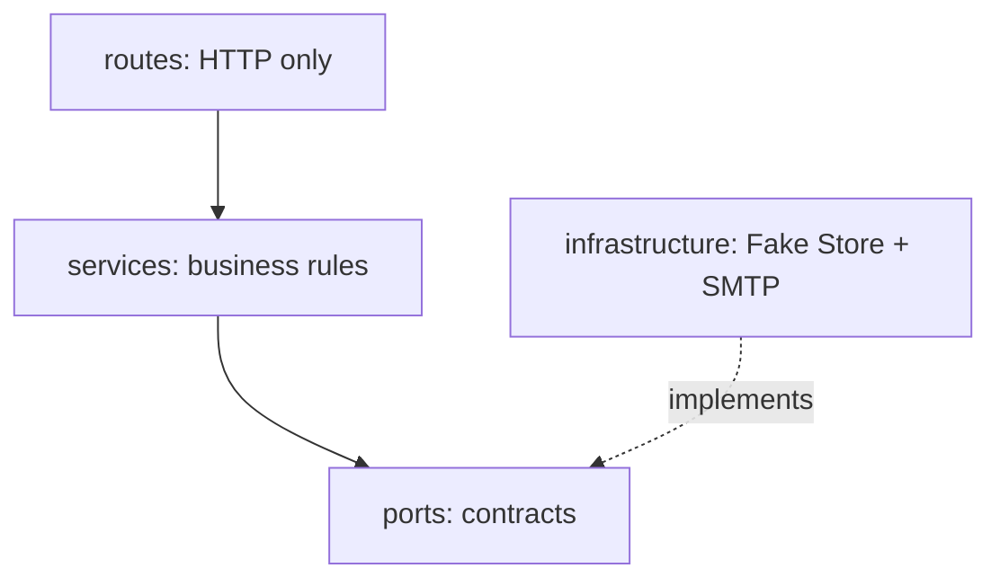
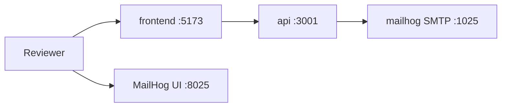

# How the product catalogue works

Short explanation of the plan and runtime flow. Use this in the interview walkthrough.

## 1. Big picture

Customer uses the React app. The app never talks to Fake Store. Everything goes through our API. Product data and email are behind ports so they can be swapped later.

**One line:** UI → API → services → ports ← infrastructure.

## 2. Customer journey (pages)

## 3. Product read flow

Example: home featured products.

Same pattern for:

| UI action | API |
|-----------|-----|
| Open home | `GET /api/products/featured` |
| Click category | `GET /api/categories/:name` |
| Click Search | `GET /api/products/search?q=` |
| Open product tile | `GET /api/products/:id` |
| Load nav categories | `GET /api/categories` |

## 4. Enquiry flow

## 5. Backend folders (why this shape)

| Folder | Job |
|--------|-----|
| `routes/` | Request in, JSON out |
| `services/` | Featured sort, category split, search, enquiry rules |
| `ports/` | Interfaces only |
| `infrastructure/` | Fake Store + Nodemailer today; DB/SES later |

## 6. Local run pieces

- App: http://localhost:5173  
- API: http://localhost:3001  
- Enquiry inbox: http://localhost:8025  

## 7. What changes later (growth story)

| Change | Touch |
|--------|--------|
| New product DB/CMS | New file in `infrastructure/`, same `ProductSource` |
| SES / SendGrid | New `EmailSender` implementation |
| New look & feel | Frontend CSS/tokens only |
| Featured = curated IDs | `CatalogService` only |
